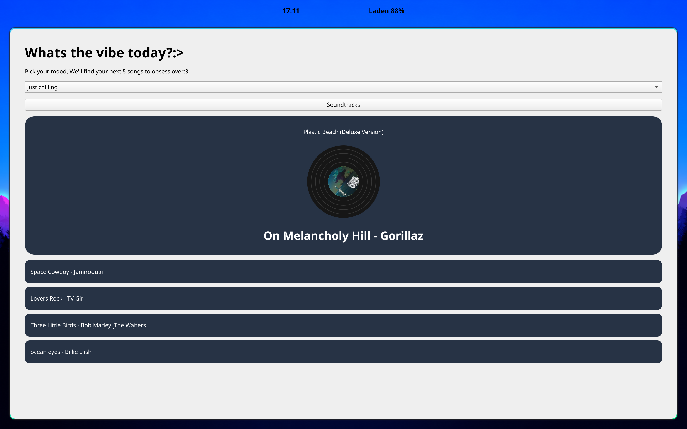

MoodFive
========

Your mood, your next five songs.

MoodFive is an app where you choose how you feel and discover five songs that match your mood. Pick a track to see its album artwork on a spinning vinyl record and hear a 15-second preview.

I built MoodFive to learn Python and PySide6 while making something around music I enjoy. It started as a desktop app and now also has a browser demo.

[Try MoodFive in your browser](https://milaaaaxx.github.io/MoodFive/)



What you can do
--------------

- Choose a mood and get five randomly selected songs from its curated list.
- Click any of the other songs to make it the featured track.
- See the selected song's album cover in the centre of a vinyl record.
- Listen to a preview of up to 15 seconds while the record spins.
- Try the browser version without installing anything.

The moods
---------

- Thriving
- Just chilling
- In my yearning era
- Brain has 47 tabs open lol
- Main character energy
- Running on 2%

Run the desktop app
-------------------

You need Python, pip, and an internet connection for album artwork and music previews.

Download this repository, or clone it:

```sh
git clone https://github.com/milaaaaxx/MoodFive.git
cd MoodFive
```

On Linux or macOS:

```sh
python3 -m venv .venv
.venv/bin/python -m pip install PySide6
.venv/bin/python main.py
```

These commands use the virtual environment directly, so they also work in Fish without an activation step.

On Windows, using PowerShell:

```powershell
py -m venv .venv
.\.venv\Scripts\python.exe -m pip install PySide6
.\.venv\Scripts\python.exe main.py
```

Using MoodFive
--------------

Choose a mood from the dropdown and click **Soundtracks**. The first song appears in the large player card, with the other four underneath. Click another song to switch tracks.

In the browser demo, click **Play** if your browser does not start the preview automatically. The demo also links to the selected song in the iTunes Store.

How it works
------------

The desktop app uses Python and PySide6. The browser version uses HTML, CSS, and JavaScript and is hosted on GitHub Pages.

Songs come from curated mood lists. Album information, artwork, and preview links come from the iTunes API. Preview availability depends on the track and store; MoodFive plays short streamed samples rather than full songs.

Project files
-------------

| File | Purpose |
| --- | --- |
| `main.py` | Desktop interface, song selection, network requests, and audio playback |
| `song.py` | Moods and their song lists |
| `vinyl.py` | Custom vinyl drawing, album artwork, and rotation animation |
| `music_lookup.py` | Standalone music lookup experiment |
| `docs/` | Browser demo published through GitHub Pages |
| `images/` | Screenshots from development |

Credits
-------

Made by [milaaaaxx](https://github.com/milaaaaxx) for Hack Club Terra.

Song previews provided courtesy of iTunes. Music and album artwork belong to their respective rights holders.
